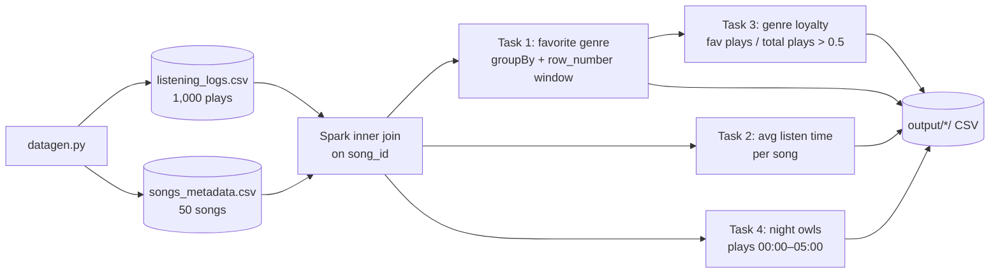

# Spark Music Streaming Analysis

Analyzes listener behavior for a music-streaming service with **PySpark Structured APIs** (DataFrames, joins, window functions). It finds each user's favorite genre, average listen time per song, genre-loyalty scores and late-night listeners across 1,000 listening events.


[](https://github.com/Poojitha220403/spark-music-streaming-analysis/actions/workflows/ci.yml)

## Problem

Streaming platforms personalize recommendations and marketing from raw play logs. Turning millions of `(user, song, timestamp, duration)` events into segments like "loyal jazz fans" or "night owls" is a distributed join-and-aggregate problem, which is what Spark is built for.

## Architecture



## Tech stack

| Area | Tools |
|---|---|
| Processing | PySpark: DataFrame API, `Window.partitionBy().orderBy()`, `row_number()`, joins, aggregations |
| Data | Synthetic CSVs from `datagen.py` (pandas) |

## How to run

```bash
pip install -r requirements.txt     # pyspark, pandas (Java 17 is needed for Spark)
python3 datagen.py                  # regenerate listening_logs.csv + songs_metadata.csv
spark-submit main.py                # or: python3 main.py
```

Results are written to `output/<task>/part-*.csv`.

## Results

From the committed run ([`output/`](output/)):

| Task | Result |
|---|---|
| 1. Favorite genre per user | 100 users. Classical is the most common favorite (31 users), then Jazz (23), Rock (20), Hip-Hop (15) and Pop (11) |
| 2. Average listen time | 50 songs; longest average is `song_19` at **201.3 s** |
| 3. Genre loyalty > 0.5 | **9 loyal users**. Top: `user_39` (Hip-Hop, 0.80) and `user_75` (Jazz, 0.75) |
| 4. Night owls (00:00–05:00) | **85 users** played at least one song after midnight |

## Screenshots

Not applicable: the outputs are the CSV tables above.

## Repo structure

```
.
├── datagen.py            # synthetic logs + song metadata
├── main.py               # the four Spark analysis tasks
├── listening_logs.csv
├── songs_metadata.csv
├── output/               # task results (CSV)
└── requirements.txt
```
